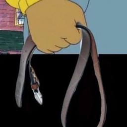

# Clanka Spanka

A meme weapon for a vanilla Minecraft Java **26.2** server: the leather belt from the Arthur fist meme.
It is a datapack plus a resource pack. Players need no mods and the server needs no mod loader or plugins.



## What it does

- **The Clanka Spanka**: an iron sword in disguise (same damage, speed, and durability) with a belt look,
  no enchantment glint, and the lore line "for the clankas".
- **Every hit**: a cartoon whip sound, a burst of crit sparks, +1 knockback, and a gold "WHAP!" that pops up
  over the target and floats away.
- **Hitting a clanker** (any player or mob on the `clankers` team): +5 damage, a red "CLANKA SPANKA!" popup,
  and +1 on that clanker's spank count. All of this is editable; see [Changing what a spank does](#changing-what-a-spank-does).
- Clankers get a red `[CLANKER]` prefix on their name.
- **Recipe**: 2 leather + 1 iron nugget, in any arrangement. It shows up in the recipe book once you hold leather.
- **Give command**: `/function clanka_spanka:give` (needs op).
- The arm swing is the normal sword swing. Vanilla 26.2 only offers a whack, a stab, or no swing, so a real
  whip animation would need a client mod.

## Install on a server

1. Build the two zips: `python tools/build.py` (Python 3.10+, standard library only). This writes
   `dist/ClankaSpanka-datapack.zip` and `dist/ClankaSpanka-resourcepack.zip` and prints the resource pack SHA-1.
2. **Datapack**: copy `ClankaSpanka-datapack.zip` into `<world>/datapacks/`, then run `/reload` or restart.
   `/datapack list enabled` should list `file/ClankaSpanka-datapack.zip`.
3. **Resource pack** (the belt look and the sound), either:
   - host the zip at a direct download URL and set in `server.properties`:
     `resource-pack=<url>` and `resource-pack-sha1=<sha1 from build.py>` (optionally `require-resource-pack=true`),
     then restart. The SHA-1 changes on every rebuild; or
   - have each player put the zip in `.minecraft/resourcepacks/` and turn it on.

   Without the resource pack the belt still works, but it looks like an iron sword and the hits are silent.
4. PvP must be on for players to hit player bots: `/gamerule pvp true` (that is the default).

## Picking the clankers

Clankers are members of the `clankers` team. Membership is by player name and can change while the server
runs, from op chat, the server console, or RCON (so a homelab script can manage it):

```
team join clankers <name>     # works even when <name> is offline
team leave <name>
team list clankers
team join clankers @e[type=zombie,limit=1,sort=nearest]    # mobs work too, handy for testing
```

- The team is created the first time the datapack loads. Its red `[CLANKER]` prefix is set only then, so a
  change like `team modify clankers prefix {text:"[BOT] ",color:"gold"}` or `team modify clankers color gold`
  survives `/reload`.
- A player can only be on one team at a time. If the bots already need a different team, change the team
  name in both places that check it: `"minecraft:team": "clankers"` in
  `datapack/data/clanka_spanka/enchantment/clanker_spanking.json` and `@s[team=clankers]` in
  `datapack/data/clanka_spanka/function/whap.mcfunction`.
- Players stay on the team when they die; mobs are removed from it when they die.

## Changing what a spank does

- **`datapack/data/clanka_spanka/function/spank.mcfunction`** runs as and at the clanker right after every
  hit. Add, remove, or change commands there (it has commented examples: slowness, levitation, a chat
  message), rebuild, and `/reload`.
- **Extra damage** is the `"value"` under `"minecraft:damage"` in
  `datapack/data/clanka_spanka/enchantment/clanker_spanking.json` (default `5.0`). It lives there rather
  than in `spank.mcfunction` because it has to be part of the hit itself. Knockback for every hit is
  `"minecraft:knockback"` in the same file.
- **Spank count** (for example as a training signal):
  - read: `scoreboard players get <name> clanka_spanked`
  - reset: `scoreboard players reset <name> clanka_spanked`
  - show to everyone: `scoreboard objectives setdisplay sidebar clanka_spanked`

To try an edit on a live server without rebuilding, unzip the datapack into a folder inside
`<world>/datapacks/` (and remove the zip), edit the files there, and run `/reload`.

## How it works

The belt is recognized by its hidden enchantment `clanka_spanka:clanker_spanking`, not by its name, so
renaming it in an anvil changes nothing.

| File | Role |
|---|---|
| `datapack/pack.mcmeta` | Datapack metadata; format 107.1 = Minecraft 26.2 |
| `datapack/data/clanka_spanka/enchantment/clanker_spanking.json` | The hidden enchantment: extra damage against the `clankers` team, +1 knockback, the hit sound, and a call to `whap` |
| `datapack/data/clanka_spanka/function/whap.mcfunction` | Every hit, run as the target: sparks, then `spank` for clankers or a "WHAP!" popup for everything else |
| `datapack/data/clanka_spanka/function/spank.mcfunction` | What a spank does to a clanker (meant to be edited) |
| `datapack/data/clanka_spanka/function/tick.mcfunction` | Grows, floats, and removes the popups |
| `datapack/data/clanka_spanka/function/load.mcfunction` | Creates the scoreboards and the `clankers` team |
| `datapack/data/clanka_spanka/function/give.mcfunction` | Give command. **Generated** by `tools/build.py` |
| `datapack/data/clanka_spanka/recipe/clanka_spanka.json` | Recipe. **Generated** by `tools/build.py` |
| `datapack/data/clanka_spanka/advancement/recipes/clanka_spanka.json` | Adds the recipe to the recipe book once a player has leather |
| `datapack/data/minecraft/tags/function/tick.json`, `load.json` | Hook `tick` and `load` into the game loop |
| `resourcepack/pack.mcmeta` | Resource pack metadata; format 88.0 = Minecraft 26.2 |
| `resourcepack/assets/clanka_spanka/items/clanka_spanka.json` | Points the item at its model |
| `resourcepack/assets/clanka_spanka/models/item/clanka_spanka.json` | Flat item model; `display` sets how it hangs in the hand |
| `resourcepack/assets/clanka_spanka/textures/item/clanka_spanka.png` | 16x16 belt texture (drawn by `tools/make_texture.py`) |
| `resourcepack/assets/clanka_spanka/sounds.json`, `sounds/whip.ogg` | The hit sound (made by `tools/make_sound.py`) |
| `tools/build.py` | Writes the recipe and give function from `COMPONENTS` / `RECIPE`, zips both packs, prints the SHA-1 |
| `tools/make_texture.py` | Draws the texture; given a meme image path, also redraws both `pack.png` icons |
| `tools/make_sound.py` | Downloads the whip clip, trims it, and matches its loudness to vanilla's sweep attack |

## Changing other things

- Item name, lore, model, recipe, or base item: `COMPONENTS` / `RECIPE` in `tools/build.py`. Do not edit the
  generated recipe or give function; `build.py` overwrites them.
- Popup words and colors: `whap.mcfunction` ("WHAP!") and `spank.mcfunction` ("CLANKA SPANKA!").
  Popup size, float, and lifetime: `tick.mcfunction`.
- Texture: edit the pixel grid in `tools/make_texture.py` and run `uv run tools/make_texture.py`, or replace
  the PNG with any 16x16 image.
- How it hangs in the hand: `display` in `resourcepack/assets/clanka_spanka/models/item/clanka_spanka.json`.
- Sound: replace `resourcepack/assets/clanka_spanka/sounds/whip.ogg` with any mono `.ogg`.

Then run `python tools/build.py` again. (`make_texture.py` and `make_sound.py` need [uv](https://docs.astral.sh/uv/);
their outputs are already committed, so they are only needed to redo the art or the sound.)

## Testing a change

1. Load the datapack on a 26.2 server (or `/reload`) and check the server log: any error mentioning
   `clanka_spanka` means a file was rejected. A bad enchantment file stops the whole pack from loading.
2. In game, with the resource pack on:
   ```
   /function clanka_spanka:give
   /summon zombie ~3 ~ ~
   /team join clankers @e[type=zombie,limit=1,sort=nearest]
   ```
   Hit it: you should hear the whip, see a red "CLANKA SPANKA!", and it should drop faster.
   `/scoreboard players list @e[type=zombie,limit=1,sort=nearest]` shows its spank count.
   A zombie that is not on the team gets a gold "WHAP!" and normal damage.

Checked on a 26.2 server (2026-11-10), with a zombie holding the belt: a player on the team took 13 per hit
and a player not on it took 8. The count went up for every hit on the team player, including the killing
hit. A name added while that player was offline was on the team when it joined, and a changed prefix
survived `/reload`.

## Known limits

- A grindstone removes the hidden enchantment: the item keeps the belt look but loses the bonus, sound, and popups.
- Repairing two belts in the crafting grid may give a plain iron sword (untested); anvil repair keeps the belt.
- Bedrock players (for example through Geyser) do not get Java resource packs.

## Credits

- Hit sound: "Whip (Crack) - Sound Effect | ProSounds", https://www.youtube.com/watch?v=-EeXrcGEa88
- Pack icon: the Arthur fist meme.
